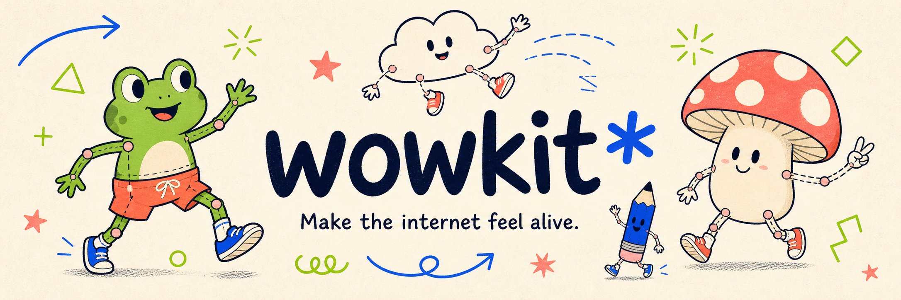
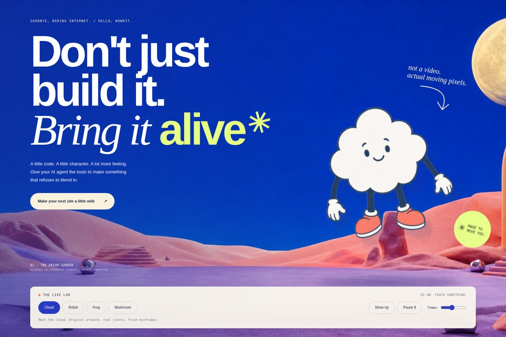
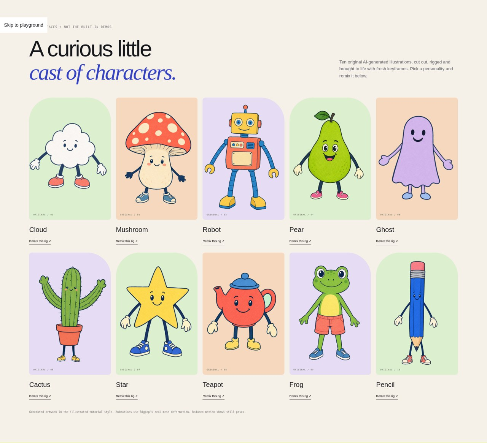
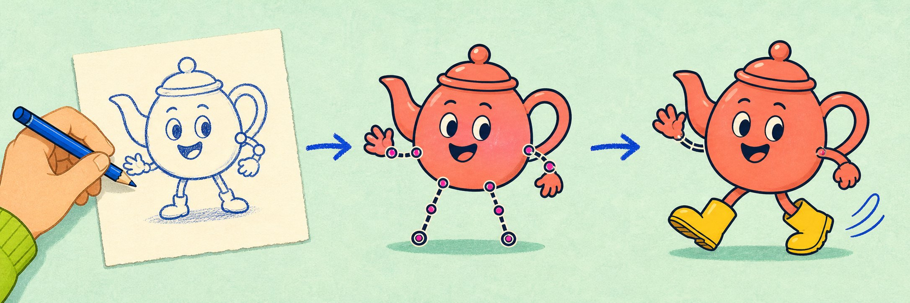
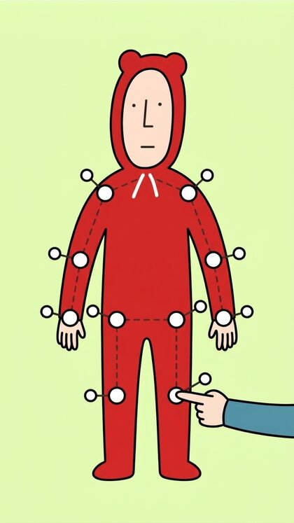
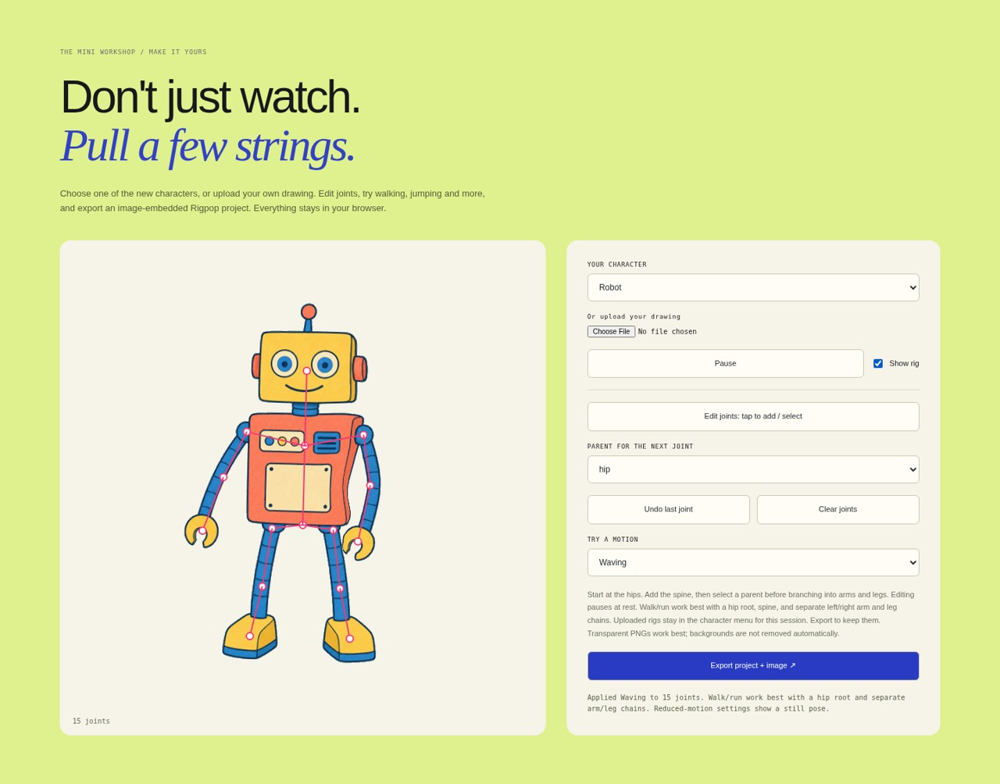

<p align="center">
  
</p>

<p align="center">
  <strong>A little code. A little character. A lot more feeling.</strong><br>
  A design playbook, original animated characters, and a tiny rigging workshop for websites that refuse to blend in.
</p>

<p align="center">
  <a href="#get-it-running">Get started</a> ·
  <a href="#meet-the-cast">Meet the cast</a> ·
  <a href="#your-drawing-alive">Try the workshop</a> ·
  <a href="AGENTS.md">Agent playbook</a> ·
  <a href="docs/MOTIONS.md">Motion guide</a>
</p>

---

## Less template. More personality.

Your coding agent can write the code. **Give it a point of view—and something worth animating.**

Wowkit combines an opinionated design workflow with the actual [Rigpop](https://github.com/swapagrawal14/rigpop) Canvas renderer. Drawings bend through joint-driven mesh skinning, not just a CSS wiggle on a flat image.

<p align="center">
  
  <br><sub>Real website screenshot. The landscape is AI-generated; the character is rendered live by Rigpop.</sub>
</p>

| Bring the personality | Keep the substance |
| :--- | :--- |
| **10 original illustrated characters**, each with a rig and fresh keyframes | Plain HTML, CSS, ES modules and Canvas 2D |
| **8 motion presets**, from gentle floating to walking and jumping | No runtime packages, API keys or backend required |
| **An inline workshop** to upload, rig, preview and export | Local image processing; uploaded images aren't sent to a server |
| **A living showcase** with interactive scenes and little page walkers | Reduced-motion support, pause controls and offscreen rendering suspension |
| **A playbook for coding agents**, not just a pretty starter page | Design recipes, reusable effects and honest verification tools |

## Get it running

```sh
git clone https://github.com/swapagrawal14/wowkit.git
cd wowkit
npm run dev
```

Open **http://localhost:3000**. No `npm install` needed for the website.

**Requirements:** Python 3 for the static server; Node.js 18+ and npm for the scripts. Serve over HTTP—ES modules and image loading won't work reliably through `file://`.

<details>
<summary><strong>Prefer running without npm?</strong></summary>

```sh
python3 -m http.server 3000 --bind 0.0.0.0
```

</details>

## Meet the cast

**Cloud · Mushroom · Robot · Pear · Ghost · Cactus · Star · Teapot · Frog · Pencil**

Ten newly generated illustrations—not the imported Rigpop demos. Each has a transparent cutout, a 15-joint skeleton and an original animation loop. Click **Remix this rig** on the website to take one into the workshop.

<p align="center">
  
</p>

Original images and cutouts live in [`assets/cast/`](assets/cast/). Their editable project files live in [`projects/cast/`](projects/cast/).

## Your drawing. Alive.

<p align="center">
  
  <br><sub>Original AI-generated workflow illustration—not an editor screenshot.</sub>
</p>

### Three small steps

<table>
  <tr>
    <td align="center" width="33%"></td>
    <td align="center" width="33%"></td>
    <td align="center" width="33%"></td>
  </tr>
  <tr>
    <td valign="top"><strong>01 / Pick your picture.</strong><br>Choose a cast member or upload a PNG, JPEG or WebP under 10 MB. Transparent PNGs work best.</td>
    <td valign="top"><strong>02 / Give it a skeleton.</strong><br>Enable joint editing. Start at the hips, add the spine, then select a parent before branching into limbs.</td>
    <td valign="top"><strong>03 / Find its personality.</strong><br>Choose a motion, preview it, and export a Rigpop project with its image embedded.</td>
  </tr>
</table>

<sub>These three tutorial illustrations come from the original Rigpop repository.</sub>

### A real mini workshop, right in the page

<p align="center">
  
</p>

- **Pick or upload:** your upload appears as **My uploaded image** in the character menu.
- **Build the rig:** tap to add/select joints, choose parents, undo the last joint or clear the skeleton. Keyboard placement supports arrow keys and Enter.
- **Preview:** show the skeleton, apply a motion, play or pause.
- **Switch freely:** returning to your uploaded image keeps its joints and animation during the current page session.
- **Keep your work:** export an image-embedded project for the full Rigpop editor.

> **Before you reload:** uploaded work is kept in memory, not permanent storage. Export to save it. A new upload replaces the previous upload.

### Pick a mood. Give it motion.

| Preset | What it does |
| :--- | :--- |
| **Walking** | Alternating limbs and a gentle body bob |
| **Running** | A quicker gait with a wider stride |
| **Jumping** | Anticipation, lift, airtime and landing |
| **Waving** | A friendly right-side arm gesture |
| **Little dance** | Body sway, arm movement and a small bounce |
| **Floating** | A gentle drift for dreamier characters |
| **Gentle sway** | Soft, phased movement along the rig |
| **Happy bounce** | A simple rhythmic lift |

Walking and running work best with a hip root and separate arm/leg chains. These are **stylized procedural gaits**, not foot-locked inverse kinematics. For unusual shapes, start with sway, bounce or float. [Read the motion guide →](docs/MOTIONS.md)

## Give your agent better ingredients

Point a repository-capable coding agent at this repo and give it a brief:

```text
Read AGENTS.md and docs/SCENE_RECIPE.md first.

Build a website for [my idea and audience].
The primary action is [my goal]. Use [my content and assets].

Give it an original visual direction. Reuse Wowkit's Rigpop player,
motions and recipes where they serve the idea—not as a layout to copy.
Implement real interactions. Respect reduced motion and keyboard access.
Inspect desktop and mobile screenshots, and report what you actually tested.
```

If the agent can't read repositories, provide [`AGENTS.md`](AGENTS.md) and the relevant source files directly. A repo link is a starting point, not a guarantee of good design.

## Put a character in your own page

```html
<canvas id="mascot" aria-label="Animated frog mascot"></canvas>
<script type="module">
  import { createProjectPlayer } from './player/project-player.js';
  import { makeMotion } from './player/motions.js';

  const response = await fetch('./projects/cast/frog.json');
  if (!response.ok) throw new Error('Could not load the character');
  const project = await response.json();
  project.animation = makeMotion('walk', project.joints, project.size);

  const player = createProjectPlayer(document.querySelector('#mascot'));
  await player.load(project, document.baseURI);
  // player.setPaused(true); player.setBones(true);
  // Call player.destroy() when unmounting the component.
</script>
```

Images resolve relative to the base URL passed to `load()`, **not the JSON file's location**. Keep parent joints before children. Add a visible pause control when using continuous animation. See [`workshop.js`](workshop.js) for a complete working integration.

<details>
<summary><strong>What's in the box?</strong></summary>

| Path | Purpose |
| :--- | :--- |
| [`AGENTS.md`](AGENTS.md) | Design workflow, guardrails and delivery expectations |
| [`player/project-player.js`](player/project-player.js) | Read-only Rigpop project renderer |
| [`player/motions.js`](player/motions.js) | Eight reusable, loop-safe motion presets |
| [`workshop.js`](workshop.js) | Original-cast gallery and mini rigging editor |
| [`walkers.js`](walkers.js) | Header/footer character walks |
| [`effects/`](effects/) | Progressive scroll reveals and pointer lighting |
| [`styles/presets.css`](styles/presets.css) | Signal, Nocturne and Clay design tokens |
| [`recipes/`](recipes/) | Editorial, product and portfolio page guides |
| [`examples/studio/`](examples/studio/) | Fictional editorial studio example |
| [`vendor/rigpop/`](vendor/rigpop/) | Original authoring editor and example assets |
| [`tools/`](tools/) | Checks, optional screenshot capture and cast build script |

</details>

## Check your work

```sh
npm run check          # Required files and local HTML asset paths
npm run test:motions   # Finite, loop-closed motion data; root-only translation
```

These are **not** a full browser or accessibility audit. See the [verification checklist](tools/VERIFY.md) and [actual test notes](TESTING.md). Screenshot capture via `npm run capture` requires an optional local Playwright installation; normal website use does not.

## A small kit, with honest edges

The mini workshop isn't the full Rigpop editor: it doesn't have automatic rigging, background removal, joint dragging, a timeline or video export. Uploaded images retain their backgrounds unless already cut out. Recipes are guides, not an automatic site generator. The project has no hosted backend or AI image-generation API built into the website.

**Built on [Rigpop](https://github.com/swapagrawal14/rigpop), by the same maker.** The renderer is adapted from the actual forward-kinematics, weighted-skinning and Canvas triangle-rendering code. Attribution and upstream licensing notes are in [Rigpop integration](docs/RIGPOP_INTEGRATION.md).

The banner, workflow art, scenery and original cast are AI-generated. Product screenshots above are captured from the running app. Optional regeneration of cast cutouts/rig data uses Python, Pillow, NumPy and OpenCV via [`tools/build_cast.py`](tools/build_cast.py); the website itself has no such runtime dependencies.

---

<p align="center"><strong>A little strange. Very much alive. ✳</strong><br><a href="AGENTS.md">Give your agent the playbook.</a></p>
